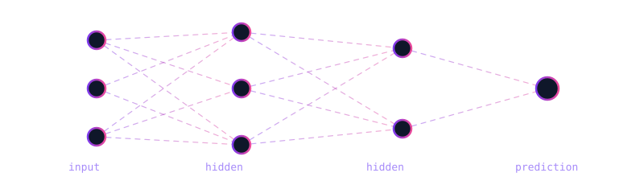

<!-- Header banner (animated wave). Change colors/text if you like --> 
  
 <h1 align="center">Hi, I'm Rasika </h1> <h3 align="center">AI/ML Learner | Python Developer | Computer Engineering @ DPGU</h3> <!-- Typing animation --> 
  
 
 I explore machine learning, deep learning, and data science by building real projects — focusing on clean code, curiosity, and turning data into something useful. 
 
     
 <!-- Profile views counter --> 
  
 
     
 <!-- Animated neural network --> 
  
 

Goal: build ML models that are accurate, explainable, and actually useful.

#Tech Stack

| Category | Tools |
|---|---|
| **Languages** | Python, SQL, C++ / Java |
| **ML / DL** | Scikit-learn, TensorFlow, Keras, PyTorch |
| **Data** | Pandas, NumPy, Matplotlib |
| **Backend / Deploy** | Flask, FastAPI, Streamlit, Docker |
| **Tools** | Jupyter, Google Colab, VS Code, Git, GitHub |

 <!-- Contribution activity graph --> 
  
 

#🎯 Goals

- [x] Master Python fundamentals
- [x] Learn core ML algorithms
- [ ] Build & deploy 5 end-to-end ML projects
- [ ] Learn deep learning with PyTorch
- [ ] Land an AI/ML internship
      

 
<i>"Data is the new code — and I'm learning to write it."</i>
 
  

